# Folio

**The open-source alternative to Notion and Confluence.**
Your team's wiki lives in Git. People write in the browser, together, in real
time. AI agents read and write the same pages. One command to run it yourself.

Website: <https://foliowiki.online> · Featured in [Self-Host Weekly (9 Oct 2026)](https://selfh.st/weekly/2026-10-09/)

### 👉 [Try the live demo](https://demo.foliowiki.online/?utm_source=github&utm_medium=readme&utm_campaign=repo)

No install, no sign-up: open it and pick Sam on the sign-in screen. Shared login, data resets every 24 hours; don't enter personal data or API keys.


```bash
git clone https://github.com/evergreen-it-dev/folio.git
cd folio
docker compose up -d
```

Open <http://localhost:4870>, create the first account, start writing.

Not ready to install? [Try the live demo](https://demo.foliowiki.online/?utm_source=github&utm_medium=readme&utm_campaign=repo) first.

---

## Why Folio

- **You own the content.** Every page is a plain file in a Git repository you
  control. No export step, no lock-in: stop using Folio tomorrow and the files
  are still there, readable in any editor.
- **It works the way a wiki should.** Real-time editing, a page tree, search,
  access rights, history, sharing — and it keeps working offline.
- **Agents are first-class users.** Not a chatbot bolted on the side: a
  built-in assistant, your own agent in every space, a full MCP server, and
  Markdown links made for agents.
- **Documents, tables, whiteboards, diagrams and files in one tree.** A
  roadmap table next to the spec, next to the architecture board, next to the
  signed PDF. Obsidian canvases and bases open as pages, too, and so do the
  interactive artifacts your agents make.
- **See how your pages connect.** A graph of the space and a local graph beside
  every page, built from the links your team already writes, and showing only
  what the reader may open.
- **Built for teams.** Groups, single sign-on with OpenID Connect and SAML 2.0,
  SCIM provisioning, an audit log and page restrictions that child pages inherit.
- **Publish what should be public.** Turn a space into a read-only website,
  with search and an optional "Ask AI" for visitors, at a path of your
  instance, on a subdomain or on your own domain.
- **One command to run.** Docker, and nothing to configure for a first start.

---

## See it in action

Short walkthroughs, no slides. The voice in the videos is synthetic.

- [A team wiki that lives in Git](https://youtu.be/tm1xB9x9HeY) — edit a page in the browser, press Sync, and it is a real Git commit; a teammate edits from the terminal and the change shows up on the page (0:37)
- [An AI agent updates your wiki over MCP](https://youtu.be/3ORtBgYlIeY) — one request: the agent reads the release process, writes release notes and adds a roadmap row (0:53)
- [Onboarding a sales rep with Folio AI](https://youtu.be/T4JXTNRrsMg) — answers from the team's own pages with sources, a weekly check as a form, and the results in a table (1:22)
- [Whiteboards that live in Git](https://youtu.be/HNK17qafhtc) — draw together, embed the board in a document, and keep every version in history (0:51)
- [Docs as code without the IDE](https://youtu.be/_e3qILMTFKg) — the `docs/` folder of a product repository becomes a space; a technical writer edits it by hand and with Folio AI, an agent adds a release entry over MCP, and the developer reads the commits with `git pull` (1:36)
- [Publish a space as a public website, with Ask AI for visitors](https://youtu.be/L8Qd4gm_0d4) — one setting makes a space a read-only site on a path, a subdomain or your own domain; visitors search it, download pages and ask Folio AI (1:21)
- [The editor and Mermaid diagrams](https://youtu.be/MfK7bhKoxSs) — live Markdown, a source view of the same page, and diagrams you edit visually or as code (1:04)
- [Is your wiki's AI assistant helping? Folio AI analytics](https://youtu.be/7aszLTDQV8w) — instance admins see rated conversations and unanswered questions, add the missing page, and the same question gets an answer with its source (1:21)
- [Publish Claude artifacts into your team wiki](https://youtu.be/F4pZzJLTf-U) — one casual line to Claude Code: the dashboard becomes an interactive page of the wiki, keeps the reader's filters after a reload, is a folder in Git, and opens for a guest by a share link (1:33)

---

## Git-first, all the way down

Most wikis keep your content in a database and offer Git as an export. Folio
does the opposite: **the Git repository is the wiki**. The database holds the
index, access rights and the state of live editing — never the only copy of
your words.

This is what a space looks like on disk:

```text
acme-handbook/
├── index.md
├── welcome-to-acme.md
├── engineering.md
├── engineering/
│   ├── onboarding-checklist.md
│   ├── release-process.md
│   ├── incident-runbook.md
│   └── how-folio-fits-together.excalidraw.svg    ← a whiteboard
├── meeting-notes.md
├── meeting-notes/
│   └── product-sync-september-28.md
├── roadmap.table.md                               ← a data table
├── onboarding-feedback.table.md
├── onboarding-feedback/
│   └── onboarding-feedback.form.md                ← a form
├── security-policy.md
├── security-policy.pdf                            ← files are pages too
└── security-policy.docx
```

And this is its history — ordinary commits, with the people who made the
changes as authors:

```text
$ git log --format='%h  %an  %s'
be529a0  Maria Chen  folio:update
aeac3bb  Maria Chen  folio:update
6c2c061  Sam Rivera  folio:update
026d9ec  Maria Chen  folio:update
...
4e9ec49  Folio       init: create space
```

What that gives you:

- **Edit anywhere.** Change a page in the browser or in your IDE and push —
  both land in the same history. Links between pages are ordinary relative
  Markdown links, not a private dialect.
- **Bring your own repository.** Start with an empty space, clone an existing
  repository, or connect one later. Several spaces can share one repository,
  each in its own folder — so documentation can live right next to the code.
- **Review like code.** Merge requests, blame, diff and revert work on your
  wiki because it *is* a repository.
- **Docs-as-code friendly.** Front matter keys written by Docusaurus, MkDocs,
  Hugo or Jekyll are kept byte for byte; a space bound to a folder such as
  `docs/` writes no ids into your files (a space over a whole repository does);
  images can be stored in the repository next to the page and linked by a
  relative path, so GitHub shows them; and moving a page rewrites the links
  that point to it and the ones inside it, in one commit. A full scenario is in
  [Docs as code, without the IDE](#docs-as-code-without-the-ide).
- **Nothing is lost quietly.** Sync state is always visible — clean, ahead,
  behind, conflict — and conflicts are listed for the whole space. "Take the
  version from Git" resets a space to the remote branch and saves what was
  there into a backup branch first.
- **Readable formats.** A whiteboard is an SVG that opens in any browser and
  still carries the editable scene. A data table is one Markdown file — the
  column types and saved views in the front matter, the rows as a table you
  can read:

```markdown
# Roadmap

| Initiative | Status | Owner | Team | Due | Effort, days | Urgent | id |
| --- | --- | --- | --- | --- | ---: | --- | --- |
| Single sign-on for enterprise plans | In progress | @alex | Engineering | 2026-10-09 | 8 | [x] | 1787nfg3 |
| New onboarding flow | In review | @sam | Design | 2026-10-02 | 5 | [ ] | b227mwwh |
| Pricing page redesign | Planned | @sam | Design | 2026-10-16 | 3 | [ ] | ndxvtpa3 |
```

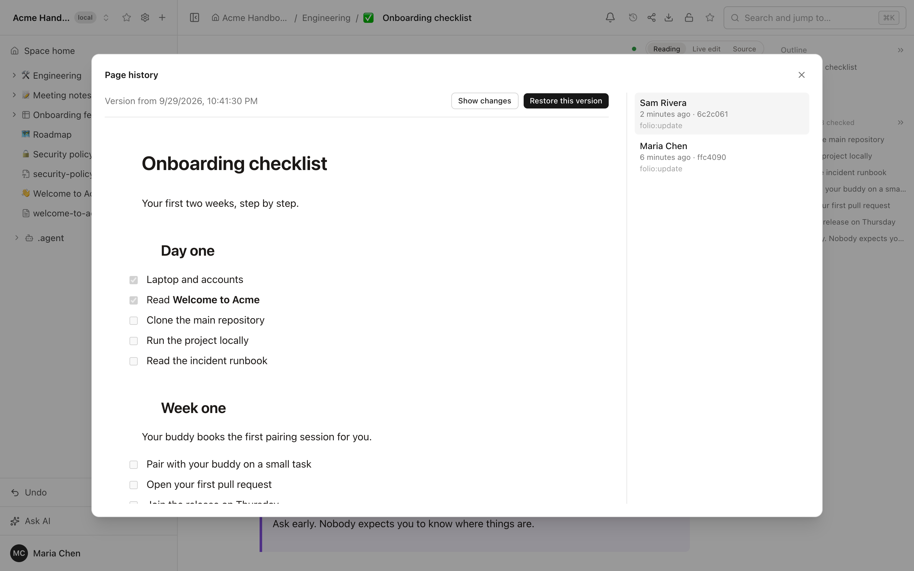

---

## Docs as code, without the IDE

If your documentation lives in the `docs/` folder of a product repository,
Folio can show that folder as a space. Writers edit it in a browser, developers
keep their IDE and read ordinary commits, and an agent works on the same pages.

- **Connect the folder, not the repository.** Create a space from the
  repository URL, choose the branch and pick `docs/` as the root path. Only
  that folder becomes the space: Markdown files are pages; source code and
  other files are not pages and are never touched. Folio keeps its page ids in
  its own index, and the only file it adds is a hidden `docs/.<slug>.folio`.
- **A writer edits in the browser.** Reading, Live edit or Source (plain
  Markdown), several people on one page, or a request to Folio AI in the side
  panel. Folio writes each edit to the file at once and commits after about 90
  seconds of quiet, or immediately on Sync, to the branch the space follows.
- **A developer sees a commit with the author's name.** `git pull`, `git log`
  and `git blame` show the person who edited as the author; Folio is the
  committer and the message is `folio:update`. Only the last editor in a window
  is recorded as author. The developer's own commits come back into the space
  by fetch roughly every three minutes and on every Sync.
- **An agent updates pages through MCP.** Claude Code, Cursor or any MCP
  client connects with a personal access token or through OAuth, reads and
  edits the same pages with the rights of the token's owner and no more, and
  the commit carries that person's name.
- **The space can become a docs portal.** Make it public and the same pages
  are served as a read-only website with search and, if you switch them on,
  downloads and "Ask AI" for visitors, see [Publish a space as a website](#publish-a-space-as-a-website).

Where it stops: a space follows exactly one branch and Folio pushes straight to
it, without pull requests (point the space at a `docs` branch if you want
review before `main`; a protected branch makes the push fail and the space
shows git's message). A space over the whole repository, with no root path,
writes an `id` into every page and a small file into the repository root,
unless an administrator ticks "Light footprint" (a repository with `.obsidian/`
is detected on its own). Opening a page writes nothing: a file changes only
when someone edits it. A page's title comes from its first `#` heading, then
from a front matter `title:`, then from the file name, and Folio does not add a
heading to a page that has none. An `id` that another tool put in front matter
(Docusaurus and Jest use `id: intro`) never moves a page between spaces. MDX
files (`.mdx`: Nimbus, Starlight, Astro, Docusaurus) are pages like `.md`
ones: `import`/`export` lines and JSX components such as `<Aside>` or `<Tabs>`
are folded into compact blocks in Live edit, drawn as labelled boxes in Reading,
and saved back byte for byte — Folio does not run MDX, it only keeps it intact.
Pasted images
stay in Folio's asset store until a space administrator turns on "Store images
in the repository". See also [What is not there yet](docs/LIMITATIONS.md).

The walkthrough is in the post
[Docs-as-code without the IDE: edit your repository's docs in a browser](https://foliowiki.online/blog/docs-as-code-in-the-browser/)
and in the [video](https://youtu.be/_e3qILMTFKg).

---

## Write together

Documents, data tables and whiteboards are edited by several people at once.
You see who is on the page and where their cursor is; changes appear as they
are typed. When the page goes quiet, Folio commits — with the person who
edited as the author.

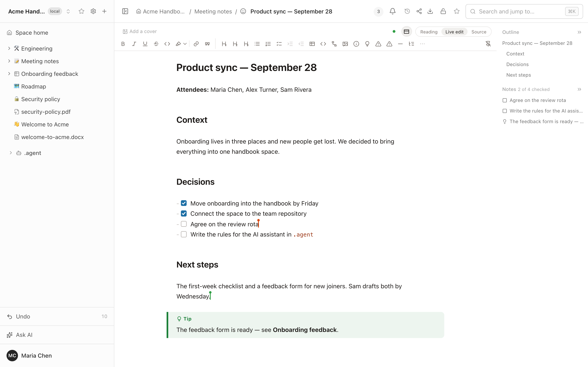

What you type is not lost between Live edit and Reading: the browser keeps a
local copy until the server confirms it has your edits. If it cannot confirm
them, the header says **Not saved** and closing the tab asks first.

**Comments on text.** Select a passage in a document and press **Comment**: the
thread sits beside the page, anyone who can see the page can reply, and an
editor (or the person who started it) resolves it. Comments are kept in the
database, not in the Markdown, so Git history stays clean. Agents read and
answer them through MCP.

---

## Side-by-side comparison

Two translations of one page, this quarter's plan next to last quarter's, a spec
next to the draft that should follow it: put up to five pages, or older versions
of a page, side by side.


- **Collect, then open.** "Compare side by side" is in the sidebar menu (also for
  people who can only read), in the page header and in the history panel. A chip
  at the bottom of the window holds the list, from any spaces you can open.
- **Live columns.** A current page is the page itself, with the same editor and
  live collaboration: type in a column and everyone on the page sees it.
- **Versions next to the page.** In a page's history, "Compare side by side with current" puts
  a read-only version beside the live page. "Highlight changes" marks what is new
  or changed in green and what was removed in red against the leftmost column,
  and synchronized scrolling keeps the columns together.


- **A link to share.** "Copy link" copies an address with only page ids and
  version numbers; whoever opens it sees each column with their own access.

Highlighting compares text block by block. See
[docs/LIMITATIONS.md](docs/LIMITATIONS.md).

---

## Works offline

On a train, on a plane, on bad hotel Wi-Fi — keep writing.

- Pages and whiteboards you have opened stay editable without a connection.
- New pages and whiteboards can be created offline and appear in the tree
  straight away.
- Everything is kept on the device and reaches the server by itself when the
  connection returns — at the same address, with no duplicates.
- Nothing is lost if you switch pages or close the tab.
- An indicator in the header shows what is waiting to be sent.

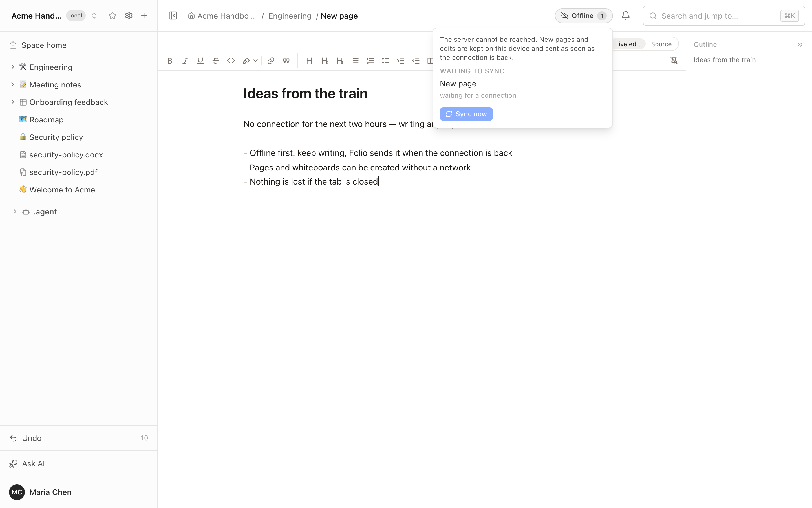

Data tables, forms and file uploads need a connection.

---

## Documents

A Markdown editor that does not make you think about Markdown. Three modes —
**Reading**, **Live edit** and **Source** — so that writers and engineers are
both at home.

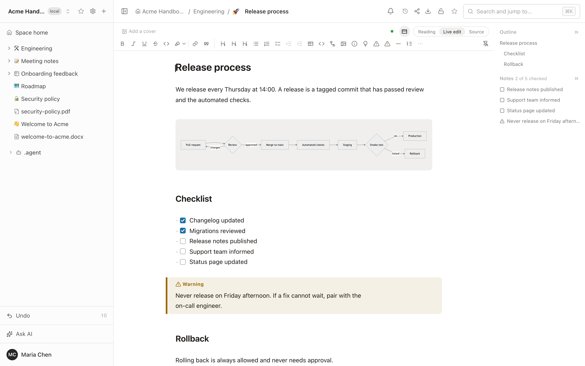

- Callouts, checklists, tables with merged cells and colors, code blocks,
  collapsible sections, highlights, `++underline++`, and coloured status
  tags like `:status[Done]{color=green}`.
- Paste from Excel and Google Docs keeps tables and formatting; copying out of
  Live edit keeps it too.
- `[[` links a page, `@` mentions a person, `/` inserts anything.
- `::pagetree` puts a live tree of child pages right into the text.
- Outline and notes panel, backlinks, page icons and covers, glossary terms
  with hover cards.
- Custom templates: any page in `_templates/`, even with subpages, becomes a
  template, with a name and description ("Make template", "From template…"); a
  new space starts with three.
- Light and dark themes, following the system or chosen by hand.

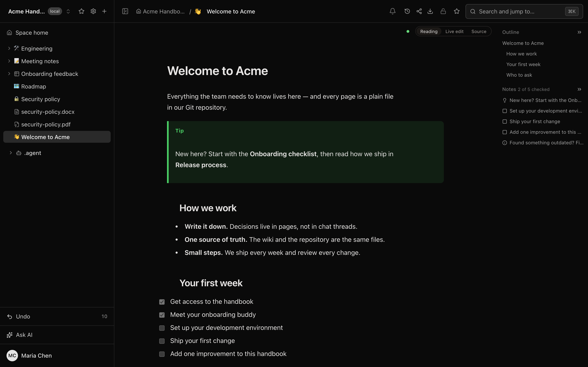

---

## Diagrams you draw, not type

Mermaid diagrams come with a visual editor. You build the diagram on a canvas,
and Folio writes the Mermaid code for you — or you type the code and watch the
canvas follow. Both sides stay in sync.

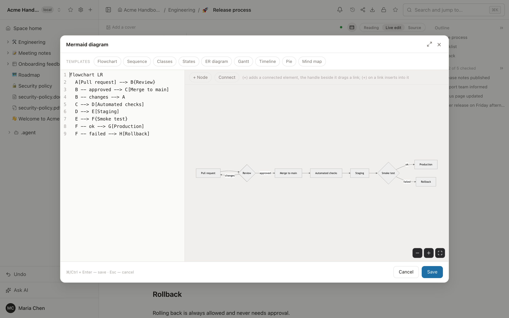

- **Click to build.** A plus on a node adds a connected one, a plus on a link
  inserts a node into it, a handle drags a new link from node to node.
- **Nine diagram types from templates**: flowchart, sequence, classes, states,
  ER, Gantt, timeline, pie, mind map.
- **Code and canvas side by side**, full screen when you need room, and a
  readable message instead of a broken picture when the syntax is wrong.
- **Still plain Markdown.** The diagram is stored as an ordinary `mermaid`
  code block, so GitHub and GitLab render it too.

---

## Data tables

Spreadsheets that belong to the wiki: typed columns, saved views, filters and
sorting — a small database you can link from any page and query from any
agent.

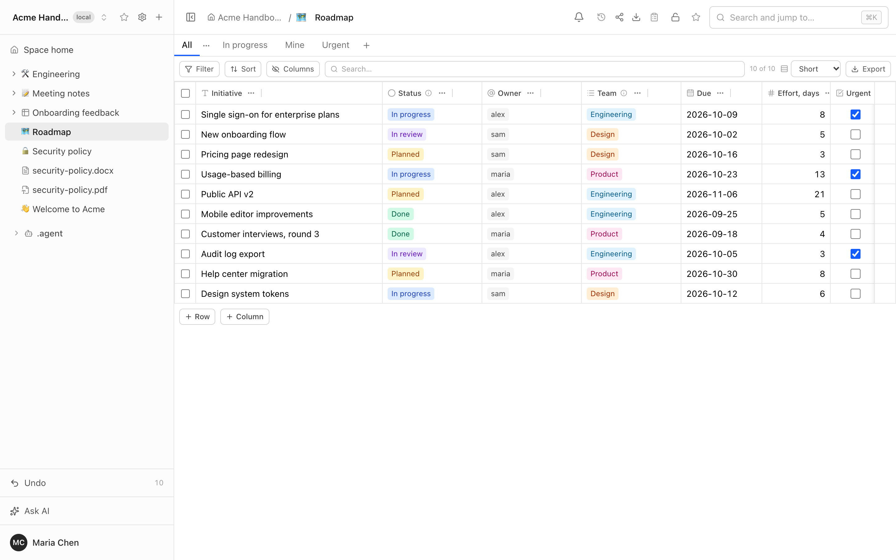

- Column types: text, long text, number, date, checkbox, select, status, user,
  link.
- Views as tabs, each with its own columns, order, widths, multi-column sort
  and `and`/`or` filters — including "me", "today", "this week".
- Edited together in real time, stored as one readable file in Git.
- Import and export; up to 20,000 rows per table.

**Forms** turn a table into a questionnaire: every answer becomes a row. A
form can be public, so people answer without an account.

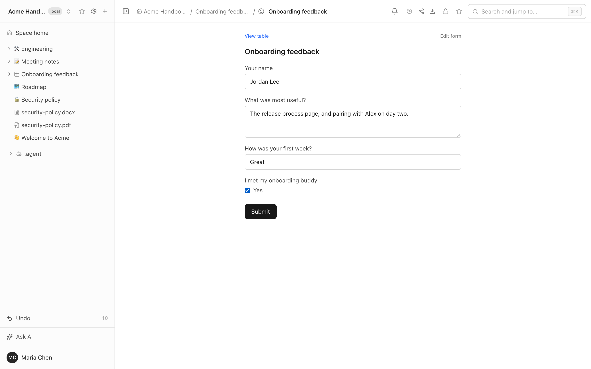

---

## Whiteboards

Excalidraw boards inside the wiki — architecture, flows, workshops. Drawn
together in real time and saved as SVG files that render anywhere.

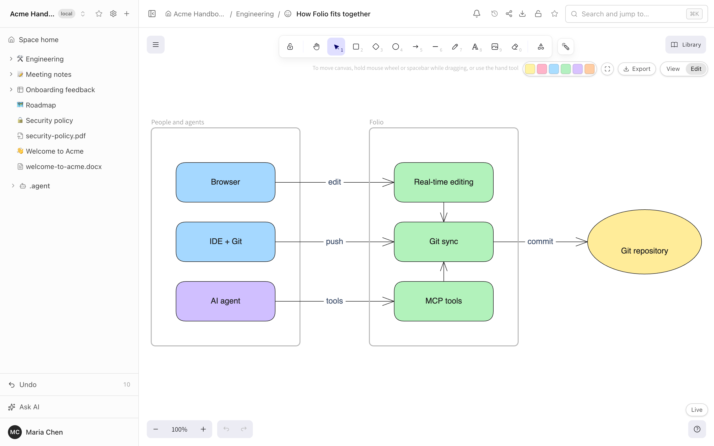

The board above was not drawn by hand. An agent created it through MCP from a
short description of boxes and arrows; people then keep editing it like any
other board.

**Reactions.** Select a shape in Edit mode and a small button appears at the
corner of its selection frame: pick an emoji (✅ ❌ 🔧 for yes, no and in progress, or 👍 ❤️ 😂 🎉 🤔 👀 🔥 👏)
and a counter chip shows under the shape.
Click a chip to add or remove your own; point at it to see who reacted.
Reactions are live for everyone on the board, and people who can only view it
(or are in View mode) see them too but cannot click them. They are kept with the board's live state, not in its SVG file.

---

## Graph

Every link between pages is already in the index, so Folio can draw it. Open
**Graph** under the tag tree and the space appears as a map: pages are nodes,
links are edges, and the biggest hubs carry their names.


- **Labels follow the zoom.** At the overview only the top hubs are named;
  zoom in and more titles fade in, never one on top of another. A hovered or
  selected page and its neighbours always keep their labels.
- **Tree structure included.** A "Tree structure" toggle adds the page tree as
  dashed lines, so a nested space is not a cloud of unconnected dots. A page of
  another space you may open shows up with its space in its name, in its own
  colour.
- **A local graph beside every document.** The page and its neighbours one to
  three links away, in, out or both, in the right-hand panel; click a node to
  open the page, or expand it to full size.


- **Filters in the search grammar** (`tag:`, `in:`, `kind:`, `prop:`), colour
  groups by top folder, page kind, tag or your own query, and the layout forces
  are settings of the graph, remembered per space.
- **Access is applied in the query.** A page you cannot open is never a node, a
  ghost or an edge. The graph is built on the server from the page index (5,000
  pages in about 150 ms) and the drawing code loads only when a graph is opened.
- **Agents can read it too.** The MCP tool `get_graph` returns the same graph, and
  the built-in assistant uses it.

The limits (10,000 pages, no graph on public sites) are in
[docs/LIMITATIONS.md](docs/LIMITATIONS.md).

---

## Obsidian canvases and bases

An Obsidian vault is not only Markdown, and Folio now opens two more of its
file types as pages.


- **Canvases (`.canvas`).** Text cards rendered as Markdown, note cards with the
  note's start, images, web page cards, groups and connections with arrows and
  colours, with pan, zoom and fit. A card that points at a page you may not open
  says "No access". "Convert to Folio board" makes a new, editable whiteboard in
  one commit and leaves the canvas as it was.
- **Bases (`.base`).** A saved query over the pages of a space, shown as a table,
  cards or a list, with grouping, sorting, formulas and column summaries. An Edit
  toggle changes a cell in place by changing that page's property, and a visual editor
  changes views, filters and formulas without disturbing the rest of the file.


Both follow renames: move a note and the canvas cards and wikilinks that point
at it are rewritten in the same commit. Bases run in a safe evaluator of our own
(no `eval`); `kanban` and `map` views and plugin functions are not supported.
Details and limits: [docs/LIMITATIONS.md](docs/LIMITATIONS.md).

---

## Artifacts: publish Claude artifacts and Cursor canvases

An AI agent builds a dashboard, a calculator or a small tool; usually it
lives in a chat and is gone with it. In Folio it becomes a page: in the tree,
in search, in Git, under the same access rights as everything else.


- **Interactive, not a screenshot.** Filters, tabs, charts and forms work on
  the page. The page runs in a sandboxed frame with no access to your Folio
  session or API, and loads scripts and fonts only from a short list of CDNs
  (cdnjs, jsDelivr, unpkg, esm.sh, Tailwind, jQuery, Google Fonts).
- **State survives.** `window.storage` (the API Claude artifacts use) and
  `localStorage` work and are kept per reader: in the database for people who
  are signed in, in the browser for guests.
- **Publish from the agent.** The MCP tool `publish_artifact` creates an
  artifact page or replaces an existing one, with extra files and the original
  source (JSX or TSX) kept next to it. In Claude or Cursor with Folio connected,
  say "publish this artifact to Folio".
- **Or import it by hand.** "Artifact…" in the "+" menu takes a link to an
  `.html`, `.zip`, `.svg` or `.md` file, a file from your computer, or pasted
  HTML. "Show source" and "Download" are on the page; replacing an artifact keeps
  its link and place in the tree.
- **Files in Git.** An artifact is a folder `<name>.artifact/` in the space's
  repository: `index.html`, an `artifact.yaml` manifest, the source and assets.
  Move, copy, trash, share links, public sites and history work like for any
  page.

A short walkthrough: [Publish Claude artifacts into your team wiki](https://youtu.be/F4pZzJLTf-U) (1:33).

Folio shows the finished page; it does not build React or TSX itself, so an
agent sends HTML that already runs, and calls to Claude, to your own APIs or to
connectors are not available inside an artifact. Share links from claude.ai or
Cursor are not downloaded: ask the agent to publish through MCP. See
[docs/LIMITATIONS.md](docs/LIMITATIONS.md).

---

## Properties and a shared timer

**Properties on every kind of page.** The thin "Properties" row above a page now
appears on data tables, forms, boards and files, not only documents. A board keeps
its properties in a small sidecar file in Git, next to the board, and they work in
search (`tag:`, `prop:`), the tag tree and MCP like any other.


**A timer that belongs to the page.** The clock icon in the header starts a
countdown (1, 3, 5 or 10 minutes, or your own) that everyone who has the page open
sees and hears end together, for a workshop or a retro. Editors control it, readers
watch.


---

## Document preview

PDF, Word, Excel and PowerPoint files are pages too. Drop one into the tree
and it opens right inside Folio — no download, no other application, no
conversion on the server.

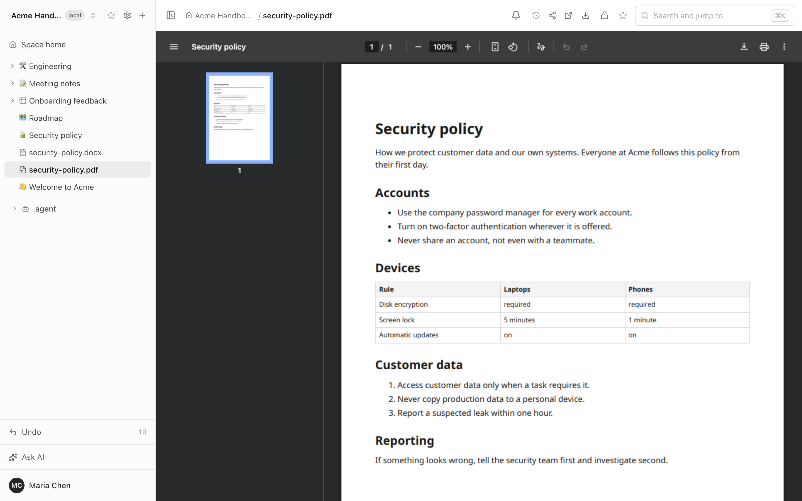

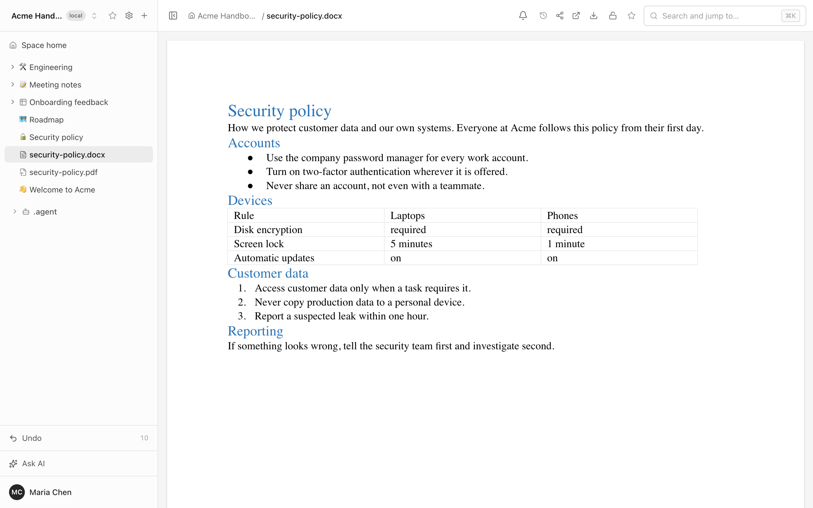

- **PDF** in the browser's own viewer: thumbnails, zoom, search, print.
- **Word, Excel and PowerPoint** rendered in the browser.
- The file sits in the space's Git repository next to the pages about it, in
  the same tree, under the same access rights.
- Open in a new tab or download with one click.
- Folio never rewrites your file: what you uploaded is byte for byte what is
  stored.
- **A new version of the file, same page.** "Replace with new version…" in
  the tree menu, the button in the page header, or drag a file onto the open
  page. The page keeps its link, place in the tree and access; the new file
  may even be another type (a deck that became a PDF), and links to it from
  other pages are rewritten. A toast offers Undo.
- **Every version stays.** Each replace is its own commit. The page history
  lists the versions with their file name and size, lets you download any of
  them (or preview a PDF) and restore one, which adds one more commit rather
  than rewriting anything.

These files are for viewing: they are not edited in Folio, and search finds
them by title.

---

## Folio AI

An assistant in the side panel that works with your wiki, not next to it.

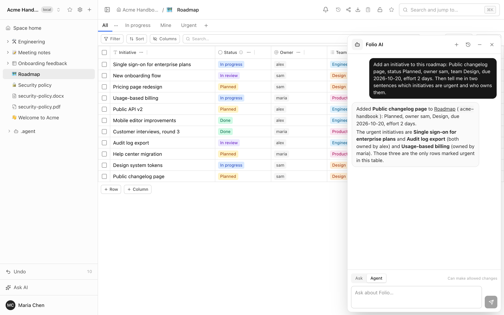

In the screenshot the assistant was asked to add an initiative to the roadmap
and say which ones are urgent. It read the table's schema, inserted the row —
it appears in the table on the left — and answered from the data.

- **Ask** — read-only. Find, summarize, compare, explain across the pages you
  have access to.
- **Agent** — reads and writes. Drafts a page, updates a table, draws a board,
  builds a form, restructures a section — inside your rights, never beyond them.
- **Runs live on the server.** Close the browser and the work continues; come
  back and pick up where it was.
- **You see what it is doing.** The status line shows the model's thinking
  with a token counter, an elapsed-time counter while it writes a long answer or
  page, and the real name of the tool it is calling; the live reply keeps its
  paragraphs and links.
- **The same tools as everyone else.** The assistant works through the very
  tools an outside agent gets over MCP — there is no second, weaker
  implementation, and in Ask mode the write tools are switched off on the
  server, not just hidden.

**It builds forms and tables, not only text.** Ask for "a lunch poll with a
required name, a cuisine and a yes/no for Friday" and the agent creates the form
and the table its answers land in, with the same steps as the form editor.


### Is the assistant actually helping?

Folio collects three signals about answer quality, without asking anyone to
fill in a form:

- **👍 / 👎 on an answer.** Every saved assistant answer can be rated
  "Helpful answer" or "Not helpful". One rating per answer, and you can change
  or remove it.
- **A short survey.** After every third answer in a conversation the panel
  asks "Did the assistant solve your question?" — Yes, Partly, No or Not now —
  with an optional comment.
- **Questions without an answer.** When the pages do not contain the answer,
  or the assistant is not sure of it, it records the question and what was
  missing — briefly, with links to the pages it did read — then still answers
  the person plainly.

Instance administrators see all of it on one page, **Assistant analytics**
(`/admin/assistant`, from the account menu): the conversations with their
ratings and survey results, and a second tab, "Questions without an answer",
which is a ready list of what your documentation is missing — the person's own
words first, the assistant's restatement below, and links to the pages
the assistant read. Both tabs filter by space,
user and date. A space administrator sees the same page limited to the spaces
they administer: only conversations that ran there, and only the messages of
those runs. An administrator can open a conversation to read it; the
conversation page lists who opened it and when, and every opening is written
to the audit log. Other people do not see this page.

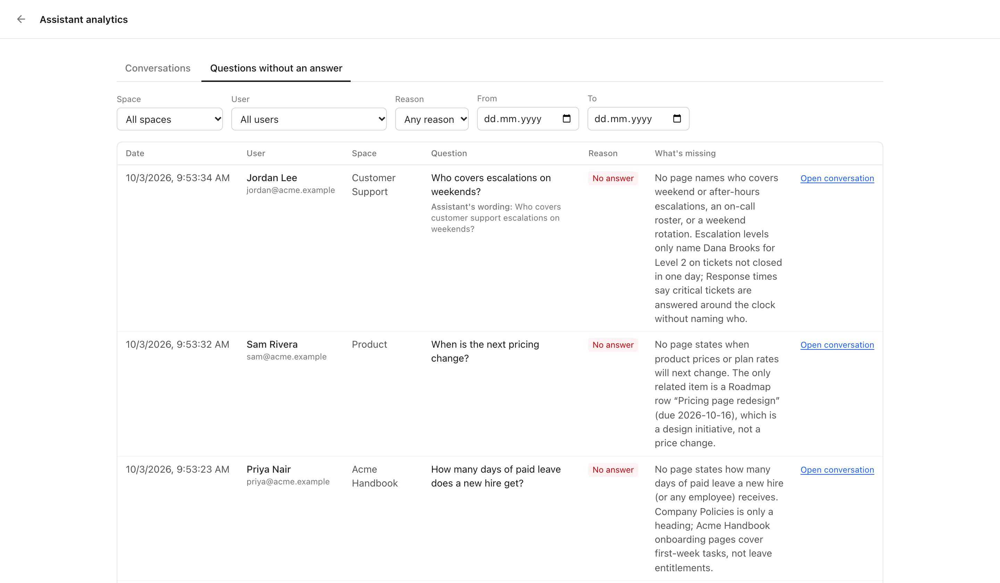

### Your own agent in every space: `.agent`

Every space has a `.agent` folder. Whatever you put there becomes the
assistant's instructions **for that space** — and it is written as ordinary
Folio pages, not as configuration.

- **Build an agent by writing pages.** Its role, its tone, the glossary, the
  rules it must follow, the templates it should use, the process it should
  walk people through.
- **A different agent for every team.** The support space gets an agent that
  answers like support. The engineering space gets one that knows the release
  process. Legal gets one that never improvises. Same Folio, different
  agents.
- **Versioned like everything else.** The instructions live in Git: you can
  see who changed the agent's behavior, review the change, and roll it back.
- **Owned by administrators.** Only space administrators see and edit
  `.agent`; everyone else just gets a better assistant.

The instructions apply to every run in the space, in Ask and Agent modes
alike.

**Writing rules, checked before you ship.** Put a page named
`writing-rules` in `.agent` (administrators get a "Create writing rules"
button that adds a starter: plain language, one idea per paragraph, headings
as nouns, no marketing words, define acronyms, numbered steps) and every page
of the space can be linted against it, whoever wrote it. Open a page and choose
**Check against writing rules**: the assistant runs read-only and lists each
finding with the rule it breaks, the quoted fragment and a suggested rewrite;
**Fix with Agent** hands the findings to Agent mode, which edits only those
fragments. The check needs the rules page and a working Folio AI key; without
them the button is missing or disabled with the reason. External agents (Claude
Code, Cursor) call the MCP tool `check_page_writing_rules` to get the same
rules and the page before they write.

### Bring your own key

Folio does not resell AI and does not mark it up. The assistant runs on a
Cursor key: your own, or one that an administrator provides for a space or for
the whole instance. Whoever owns the key pays.

| Provider | Status |
|---|---|
| Cursor | **available** — each person connects their own key, or an administrator provides one for a space or for the whole instance |
| Others | not supported yet |

**Who pays.** A run uses the first key that exists: the person's own key, then
the key of the space, then the key of the instance, then `CURSOR_API_KEY` from
the server environment. A space administrator sets a space's key (space menu,
"Folio AI key"); an instance administrator sets the instance key and can turn
personal keys off, so everyone uses the shared one. Shared keys are stored
encrypted and are never shown again after saving; every change is in the audit
log. Visitors of a [public site](#publish-a-space-as-a-website) have no key of
their own, so their questions run on the key of the space, of the instance or
of the server environment, in that order.

Without a key everything else in Folio works as usual.

---

## Built for agents

**MCP server.** 49 tools over `/mcp`: list and search spaces, read and write
pages, build forms, edit data table columns and views, convert a canvas to a board, read a page's outline, tags, properties and links, list a space's tags and
property keys, rename a tag, set page properties, find unresolved links
and orphan pages, read the link graph, query, create and edit Obsidian bases, create and edit whiteboards, publish interactive artifacts, list templates and create pages from them, query and update data tables,
read history, read and write comment threads, check a page against the space's writing rules.
Connect with a personal access token, or through OAuth 2.1 from clients that
run in a vendor's cloud (claude.ai, Claude Desktop, ChatGPT). `search` and
`fetch` are there for ChatGPT deep research.

```bash
claude mcp add folio --transport http https://wiki.example.com/mcp \
  --header "Authorization: Bearer folio_pat_…"
```

**Ready-made setups.** Files for Claude Code (a plugin and a skill), Cursor,
VS Code, Codex, n8n (two importable workflows), Open WebUI, ChatGPT and Claude
live in [integrations/](integrations/): configs with placeholders, rules for
the agent and step-by-step instructions.

**Markdown for an agent.** Any page — with its child pages, if you want — is
one link that returns clean Markdown. No scraping, no HTML, no login flow:

```bash
curl https://wiki.example.com/share/<token>.md
```

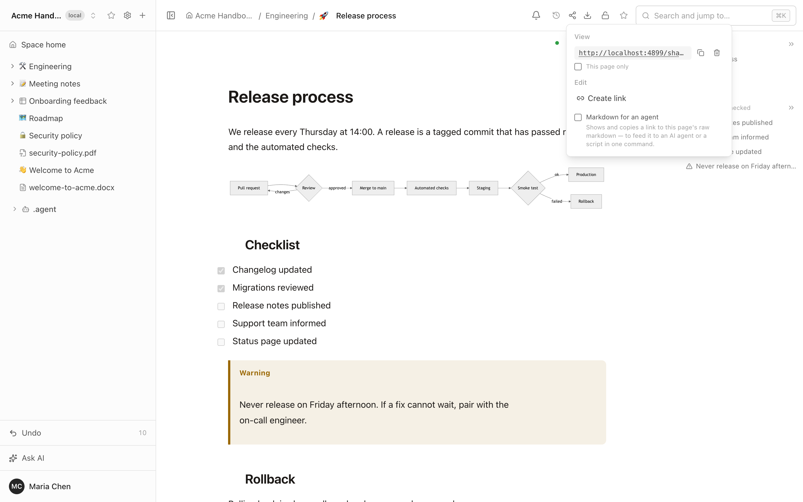

**Export in the formats agents and people need**: Markdown, YAML, PDF, DOCX,
or a zip of a whole space.

For claude.ai or ChatGPT, add `https://wiki.example.com/mcp` as a custom
connector, sign in to Folio and allow `read` or `read` + `write` on the consent
screen. The connector acts with your rights and its writes are saved in Git
under your name. Steps: [docs/MCP.md](docs/MCP.md#oauth-connect-from-claudeai--chatgpt).

**Safe by design.** A token or an OAuth grant never has more rights than its
owner, a `read` token cannot write, and administrative actions are not
available to either at all. Details: [docs/MCP.md](docs/MCP.md).

---

## Moving from Confluence

Point Folio at a Confluence page or a whole tree and it brings the pages over
as Markdown — with images, code, checklists, and panels converted into
callouts. Pages come from Confluence Cloud and from on-premises
installations; whiteboards from Confluence Cloud become Excalidraw boards.

Run a test import first: not every macro has an equivalent.
[What is not there yet](docs/LIMITATIONS.md) is written down honestly.

---

## Access management

Who sees what is decided in one place, and it is visible at a glance.

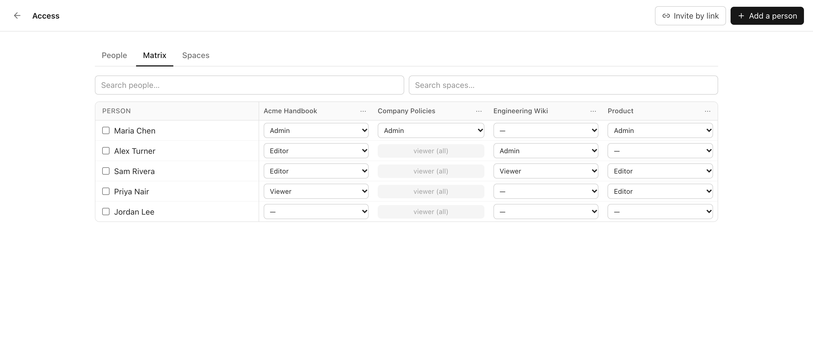

- **Roles per space**: administrator, editor, viewer.
- **Private, open or public spaces.** A private space is visible to its members
  only. A space open to the instance gives every signed-in person read access,
  and edit rights still have to be granted. A public space is also readable by
  anyone on the internet as a website, see
  [Publish a space as a website](#publish-a-space-as-a-website).
- **The access matrix.** People down the side, spaces across the top, a role
  in every cell. Change one cell or many at once.
- **An administrator is not a reader.** The instance administrator manages
  people and access but does not see the content of a private space they are
  not a member of. They can grant access to themselves — and that is written
  to the audit log and marked for everyone to see.
- **Audit log.** Every grant, revoke and visibility change is recorded with
  who did it and when. Instance administrators get a screen with filters and a
  CSV export, see [Groups and single sign-on](#groups-and-single-sign-on).

**Page-level access.** Any page can be narrower than its space: open to all
members, to you only, or to selected people or groups with view or edit rights.
A restriction is **inherited by child pages**: restricting a parent closes
everything below it, and a child can only narrow that further. The page access
dialog says who restricts a page and who can open it, and the sidebar marks
restricted pages with a lock.

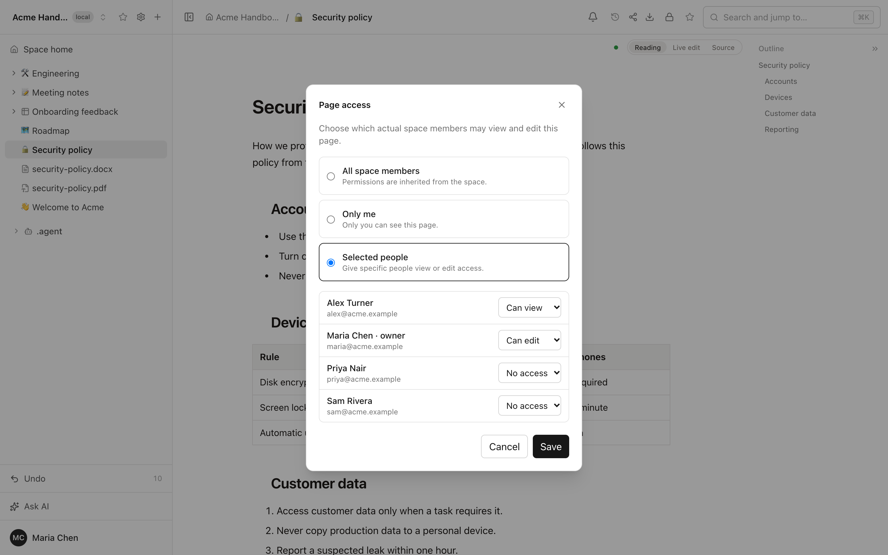

**Getting people in**

- **Invitations by link** with preset spaces and roles, an expiry date and a
  usage limit.
- **Access requests.** Someone who opens a space they cannot see can ask for
  access; administrators are notified at once and choose the role.
- **Sign-in** with email and password, or through your identity provider (see
  below). A new person gets an account and no access until someone grants it,
  unless you preset spaces for them.
- **Deactivate** an account without deleting what the person wrote: sessions,
  personal tokens and connected apps are cut off at once.

**Sharing outside**

- Share links for people without an account: view or edit, one page or a
  whole subtree (pages with their own access restrictions are left out),
  revocable at any time. A signed-in reader who can already open the page is
  sent to the normal page in their own account (`?as=guest` keeps the guest
  view).
- Forms that accept answers without an account.

**For agents and scripts**

- Personal access tokens with `read` or `write` scope, or an OAuth connection
  from claude.ai, Claude Desktop or ChatGPT (removable under "Connected apps").
  A token never has more rights than its owner, and administrative actions are
  not available to tokens at all.
- The `.agent` folder is visible to space administrators only.

**In Slack and Microsoft Teams**

- A pasted Folio link unfurls into a card with the page's title, place, opening
  text and headings, built with the access of the person who shared it; a page
  they cannot open shows no title at all. [Setup](docs/CHAT-PREVIEWS.md).

---

## Groups and single sign-on

Put people in groups, let your identity provider sign them in, and keep both in
sync without anyone doing it by hand.


- **Groups.** A named set of people (Engineering, Support, Contractors) that
  holds a role in a space or a grant on a restricted page. Give the group a role
  once; moving someone in or out changes their access everywhere. A person's
  role is the highest of their own and their groups'. Instance administrators
  create groups, managers edit the membership, space administrators grant a
  group a role in their own space. There is a Groups tab on the Access page, and
  groups appear in the matrix, the members dialog, page access and invitations.
- **Single sign-on with OpenID Connect or SAML 2.0.** Keycloak, Authentik,
  Microsoft Entra ID, Okta, Google Workspace and any other provider, several at
  once, set up at `/admin/auth` or with environment variables, with a "Test
  connection" that shows what the provider sends. The sign-in page asks for an
  email first and sends your domain to its provider. People can get an account
  at first sign-in with preset spaces, or only invited people get in.
- **Make it mandatory.** Switch off password sign-in for your domains; instance
  administrators keep an audited emergency sign-in.
- **Groups from the provider.** At every sign-in Folio adds a person to the
  Folio groups their provider reports and removes them from the ones it no
  longer does. Memberships added by hand are never touched.
- **SCIM 2.0.** Okta, Microsoft Entra ID, Keycloak (with a plugin), OneLogin and
  JumpCloud create, update and deactivate people and groups. Deactivating
  someone ends all their sessions and tokens at once.
- **Audit log and sessions.** An audit log screen for instance administrators
  with filters and a CSV export; everyone sees their signed-in devices and can
  sign out the others, and administrators can end a person's sessions.

Setup for each provider is in [docs/INSTALL.md](docs/INSTALL.md#single-sign-on-openid-connect);
what is not covered (LDAP, single logout, encrypted SAML assertions) is in
[docs/LIMITATIONS.md](docs/LIMITATIONS.md).

---

## Publish a space as a website

One setting turns a space into a read-only website for people without an
account. Open the space menu, choose **Publish as website** and make the space
public. It is the same space, not a copy: edit a page and the site shows the
change. Signed-in people read a public space the way they read any space that is
open to the instance. Typical uses: a documentation portal built from the
`docs/` folder of a repository (see
[Docs as code, without the IDE](#docs-as-code-without-the-ide)), a public
handbook, a changelog.

<!-- screenshot: public site -->

A short walkthrough: [Publish a space as a public website, with Ask AI for visitors](https://youtu.be/L8Qd4gm_0d4) (1:21).

How the site looks is kept in your repository, not in the database. Open the
space menu, choose **Site & PDF settings…** and one page edits the site title,
description, language, favicon, logo and social image, the site's stylesheet
and the PDF header, footer and print styles. Everything is saved as files in a
`.folio/` folder at the root of the space's content (`site.json`, `site.css`,
`export.css`, `pdf-header.html`, `pdf-footer.html` and `assets/`), one commit
per save, so you can edit the same files in Git too. Search engines get a
`<head>` per page, `robots.txt` and `sitemap.xml`; an "index this site" switch
and a primary address are in the publishing dialog.

| Address | When it works |
|---|---|
| `https://wiki.example.com/public/<space>` | Always, as soon as the space is public. Nothing to set up. |
| `https://<label>.sites.example.com` | When the operator sets `PUBLIC_SITES_DOMAIN=sites.example.com` and the space administrator picks a label. Needs wildcard DNS, a wildcard certificate and a reverse proxy that routes those hosts to Folio. |
| `https://docs.example.com` | A custom domain for one space: a CNAME to the host of your Folio, and the reverse proxy routing that host to Folio, with a certificate for it. |

- **What visitors get.** The page tree, search inside the space, documents,
  data tables (live, read-only), whiteboards as pictures, forms (view only) and
  PDF and Office files, with breadcrumbs and a layout for phones.
- **Downloads** as Markdown, PDF or DOCX, switched on per space.
- **Ask Folio AI**, switched on per space: visitors ask questions and the
  assistant answers in Ask mode only, from the public pages of that one space,
  on the key of the space or the instance. It cannot change anything, and
  questions are rate limited per address and per site.
- **What is never published.** Pages with their own access restrictions, the
  `.agent` folder and templates. A restriction is inherited by child pages, so
  locking a page keeps everything below it off the site too.
- **Who can publish.** Space and instance administrators, from the browser. The
  decisions (who sees the site, where, downloads, Folio AI, indexing) live in
  the database, not in Git; the look of the site lives in `.folio/` in the
  repository and is changed by space administrators. In the public demo the
  Folio Handbook is published at
  <https://demo.foliowiki.online/public/folio-handbook>; you can try the dialog
  there (no subdomain, custom domain or Ask), and everything resets daily.
- **Search engines.** Each page carries its own title, description, Open Graph
  tags and canonical link, and a page with `unlisted: true` in its front matter
  stays out of the sitemap. The public demo is never indexed.
- **Not yet.** There is no PDF preview before saving, `site.css` cannot load
  external fonts or images (put them in `.folio/assets/`), and the rate limits
  are counted per server process.

What the operator sets up for subdomains and custom domains:
[docs/INSTALL.md](docs/INSTALL.md#public-sites). Limits:
[docs/LIMITATIONS.md](docs/LIMITATIONS.md).

---

## Run it

You need [Docker](https://docs.docker.com/get-docker/) and
[Git](https://git-scm.com/downloads). Nothing else.

```bash
git clone https://github.com/evergreen-it-dev/folio.git
cd folio
docker compose up -d
```

The first start builds the application and takes a few minutes. Then open
<http://localhost:4870> and create the first account — it becomes the
administrator.

A short welcome takes it from there: pick what to create first — a document,
a whiteboard or a data table — look through what Folio can do, and land in
your first space with that page open. Connecting an existing Git repository
is one link away on the same screen.

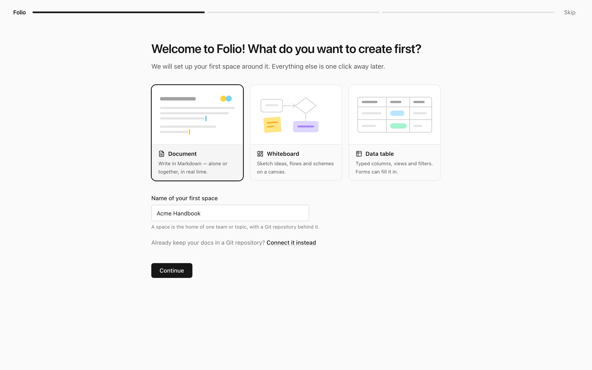

| Where | How |
|---|---|
| Your computer | `docker compose up -d` |
| A server or VPS | one command from the published image: [`deploy/vps`](deploy/vps/), or the compose file above plus `--profile https` for automatic HTTPS |
| Coolify, Railway, Render, DigitalOcean, Dokploy, CapRover, Easypanel, Portainer, Fly.io | ready-made kits in [`deploy/`](deploy/), see [One-click and PaaS](docs/INSTALL.md#one-click-and-paas) |
| Any other container platform | from the `Dockerfile`, with PostgreSQL, Redis and a persistent volume — see [requirements](docs/INSTALL.md#other-platforms) |
| Vercel, Netlify and other serverless hosting | not supported — Folio is a long-running server that keeps Git repositories on disk and holds live connections |

One click on Railway: [](https://railway.com/deploy/folio)

Domains, HTTPS, updates and backups: [docs/INSTALL.md](docs/INSTALL.md).

**No telemetry.** A Folio you run sends nothing about its use to anyone: no
analytics library is loaded and no connection is opened to the Folio authors or
to a third party. There is one opt-in exception for people who run a public
demo: set `FOLIO_POSTHOG_KEY` to a PostHog project of your own and Folio sends
anonymous events (page kinds, space slugs, never content). Without that key
nothing happens. The same holds for the optional error reporting to a Sentry
project of your own (`SENTRY_DSN`, with a "Report a problem" menu item and an
optional recording of recent actions with all text masked, off with
`SENTRY_REPLAY=0`): no DSN, no library, no connection. Details:
[docs/INSTALL.md](docs/INSTALL.md#optional-analytics-hook-off-by-default) and
[docs/INSTALL.md](docs/INSTALL.md#optional-error-reporting-off-by-default).

---

## Documentation

- [Website: foliowiki.online](https://foliowiki.online)
- [Public demo: demo.foliowiki.online](https://demo.foliowiki.online/?utm_source=github&utm_medium=readme&utm_campaign=repo) — shared login, resets every 24 hours
- Free tools, no sign-up: [Confluence to Markdown converter](https://foliowiki.online/tools/confluence-to-markdown/) · [Mermaid live editor](https://foliowiki.online/tools/mermaid-editor/)
- [Markdown templates](https://foliowiki.online/templates/): meeting notes, PRD, SOP, runbook, postmortem, onboarding checklist and more (CC0)
- Alternatives, compared honestly: [Confluence](https://foliowiki.online/alternatives/confluence/) · [Notion](https://foliowiki.online/alternatives/notion/) · [self-hosted wikis](https://foliowiki.online/alternatives/self-hosted-wiki/)
- [Installation, HTTPS, updates, backups](docs/INSTALL.md)
- [Features](docs/FEATURES.md)
- [Docs-as-code without the IDE: edit your repository's docs in a browser](https://foliowiki.online/blog/docs-as-code-in-the-browser/)
- [What is not there yet](docs/LIMITATIONS.md)
- [MCP and REST for agents](docs/MCP.md)
- [Link previews in Slack and Microsoft Teams](docs/CHAT-PREVIEWS.md)
- [Changelog](CHANGELOG.md)

## Development

```bash
cp .env.dev.example .env
docker compose -f docker-compose.dev.yml up -d   # PostgreSQL, Redis, MinIO
npm install
npm run dev                                      # http://localhost:4871
```

Node.js 22.12 or newer (22.13 or newer for the assistant). See
[CONTRIBUTING.md](CONTRIBUTING.md) — and [AGENTS.md](AGENTS.md) if your
contributor is an agent.

## Help and security

Questions and bug reports: [SUPPORT.md](SUPPORT.md). Please report
vulnerabilities privately, as described in [SECURITY.md](SECURITY.md).

## License

[MIT](LICENSE)
